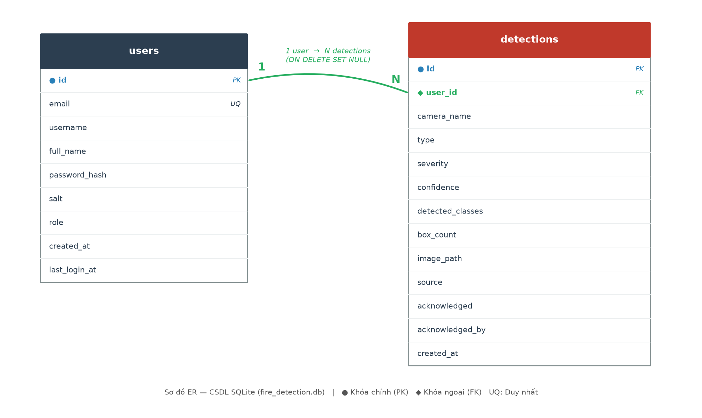

# 1. Tổng quan

Hệ thống phát hiện cháy/khói sử dụng cơ sở dữ liệu (CSDL) để lưu **tài khoản người dùng** và **lịch sử các sự kiện phát hiện cháy/khói**. CSDL cho phép:

- Đăng nhập / phân quyền người dùng (quản trị viên, nhân viên trực ca).
- Lưu lại toàn bộ sự kiện phát hiện để tra cứu lịch sử.
- Thống kê nhanh cho màn hình Dashboard (tổng số, hôm nay, chưa xác nhận, theo loại).
- Đánh dấu "đã xác nhận" cho từng cảnh báo.

# 2. Công nghệ và lý do lựa chọn

| Hạng mục | Lựa chọn |
|---|---|
| Hệ quản trị CSDL | **SQLite 3** |
| Thư viện | `sqlite3` (có sẵn trong thư viện chuẩn Python, không cần cài thêm) |
| Vị trí file | `backend/data/fire_detection.db` |
| Chế độ ghi | WAL (Write-Ahead Logging) — ghi/đọc đồng thời tốt hơn |
| Ràng buộc khóa ngoại | Bật (`PRAGMA foreign_keys = ON`) |

**Lý do chọn SQLite:** nhẹ, không cần cài đặt máy chủ CSDL riêng, toàn bộ dữ liệu nằm trong một file duy nhất — rất phù hợp cho một ứng dụng demo/đồ án, dễ triển khai và sao lưu. Mỗi luồng (thread) của Flask dùng một kết nối riêng để đảm bảo an toàn khi truy cập đồng thời.

# 3. Sơ đồ thực thể — quan hệ (ER Diagram)

CSDL gồm **2 bảng**: `users` (người dùng) và `detections` (sự kiện phát hiện). Quan hệ giữa chúng là **một–nhiều (1–N)**: một người dùng có thể tạo/liên quan tới nhiều sự kiện phát hiện, mỗi sự kiện thuộc về (tối đa) một người dùng.

# 4. Chi tiết các bảng

## 4.1 Bảng `users` — Tài khoản người dùng

Lưu thông tin đăng nhập và phân quyền. Mật khẩu **không lưu dạng thô** mà được băm an toàn.

| Cột | Kiểu | Ràng buộc | Mô tả |
|---|---|---|---|
| `id` | INTEGER | **PK**, AUTOINCREMENT | Khóa chính, tự tăng |
| `email` | TEXT | **UNIQUE**, NOT NULL | Email đăng nhập (duy nhất) |
| `username` | TEXT | | Tên đăng nhập/hiển thị |
| `full_name` | TEXT | | Họ tên đầy đủ |
| `password_hash` | TEXT | NOT NULL | Chuỗi băm mật khẩu (PBKDF2-HMAC-SHA256) |
| `salt` | TEXT | NOT NULL | Chuỗi muối ngẫu nhiên cho mỗi tài khoản |
| `role` | TEXT | NOT NULL, mặc định `operator` | Vai trò: `admin` / `operator` |
| `created_at` | TEXT | NOT NULL | Thời điểm tạo (ISO-8601, UTC) |
| `last_login_at` | TEXT | | Thời điểm đăng nhập gần nhất |

## 4.2 Bảng `detections` — Sự kiện phát hiện cháy/khói

Mỗi bản ghi là một lần hệ thống phát hiện cháy hoặc khói.

| Cột | Kiểu | Ràng buộc | Mô tả |
|---|---|---|---|
| `id` | INTEGER | **PK**, AUTOINCREMENT | Khóa chính, tự tăng |
| `user_id` | INTEGER | **FK** → `users(id)`, ON DELETE SET NULL | Người dùng liên quan (có thể NULL) |
| `camera_name` | TEXT | NOT NULL, mặc định `''` | Tên camera phát hiện (vd "CAM-01") |
| `type` | TEXT | NOT NULL | Loại: `fire` / `smoke` / `suspect` |
| `severity` | TEXT | NOT NULL, mặc định `medium` | Mức độ: `low` / `medium` / `high` / `critical` |
| `confidence` | REAL | NOT NULL, mặc định `0` | Độ tin cậy (0–1) |
| `detected_classes` | TEXT | NOT NULL, mặc định `''` | Danh sách lớp, dạng CSV: `fire,smoke` |
| `box_count` | INTEGER | NOT NULL, mặc định `0` | Số bounding box phát hiện được |
| `image_path` | TEXT | | Đường dẫn ảnh snapshot (nếu lưu) |
| `source` | TEXT | NOT NULL, mặc định `camera` | Nguồn: `camera` / `ip` / `upload` |
| `acknowledged` | INTEGER | NOT NULL, mặc định `0` | Đã xác nhận chưa (0/1) |
| `acknowledged_by` | TEXT | | Người xác nhận |
| `created_at` | TEXT | NOT NULL | Thời điểm phát hiện (ISO-8601, UTC) |

**Chỉ mục (Index)** để tăng tốc truy vấn:

- `idx_detections_created` trên `created_at DESC` — phục vụ truy vấn lịch sử mới nhất.
- `idx_detections_type` trên `type` — phục vụ lọc/thống kê theo loại.

# 5. Quan hệ và ràng buộc toàn vẹn

- **`users` (1) —— (N) `detections`** qua khóa ngoại `detections.user_id → users.id`.
- Ràng buộc **`ON DELETE SET NULL`**: khi xóa một người dùng, các sự kiện phát hiện của họ **không bị xóa** mà chỉ đặt `user_id = NULL` — bảo toàn lịch sử phát hiện (quan trọng với hệ thống an toàn).
- `email` là **UNIQUE** → không cho phép trùng tài khoản.

# 6. Bảo mật dữ liệu

- Mật khẩu được băm bằng **PBKDF2-HMAC-SHA256** với **200.000 vòng lặp** và **salt ngẫu nhiên 16 byte** riêng cho mỗi tài khoản → chống tấn công dò ngược và rainbow table.
- Khi đăng nhập, hệ thống so sánh chuỗi băm bằng `secrets.compare_digest` (chống tấn công đo thời gian - timing attack).
- CSDL không bao giờ trả mật khẩu/băm/salt ra ngoài API (hàm `_user_public` lọc bỏ các trường nhạy cảm).

# 7. Tài khoản mặc định (seed)

Khi khởi tạo CSDL lần đầu (nếu chưa có người dùng nào), hệ thống tự tạo 2 tài khoản mẫu:

| Email | Mật khẩu | Vai trò |
|---|---|---|
| `admin` | `admin123` | admin (quản trị hệ thống) |
| `sinh@gmail.com` | `111111` | operator (nhân viên trực ca) |

> **Lưu ý:** nên đổi mật khẩu mặc định trước khi triển khai thực tế.

# 8. Các API tương tác với CSDL

Backend Flask cung cấp các endpoint thao tác dữ liệu:

| Endpoint | Phương thức | Bảng | Chức năng |
|---|---|---|---|
| `/api/auth/register` | POST | users | Đăng ký tài khoản mới |
| `/api/auth/login` | POST | users | Đăng nhập, cập nhật `last_login_at` |
| `/api/users` | GET | users | Liệt kê tài khoản |
| `/api/detections` | GET | detections | Liệt kê lịch sử (có phân trang, lọc theo loại/trạng thái) |
| `/api/detections` | POST | detections | Lưu một sự kiện phát hiện mới |
| `/api/detections/<id>/ack` | POST | detections | Đánh dấu đã xác nhận |
| `/api/stats` | GET | detections | Thống kê tổng quan cho Dashboard |

# 9. Dữ liệu lưu phía trình duyệt (không nằm trong CSDL)

Một số cấu hình được lưu trực tiếp trong **localStorage của trình duyệt** thay vì CSDL, vì mang tính cá nhân theo từng máy:

| Khóa localStorage | Nội dung |
|---|---|
| `telegramConfig` | Bot Token, Chat ID, bật/tắt tự động gửi Telegram |
| `ipCameraUrl` | Địa chỉ URL camera điện thoại (CAM-02) |

# 10. Sao lưu và khôi phục

- **Sao lưu:** chỉ cần copy file `backend/data/fire_detection.db` (kèm `-wal`, `-shm` nếu có).
- **Khôi phục:** đặt lại file `.db` vào đúng thư mục `backend/data/`.
- **Khởi tạo lại từ đầu:** xóa file `.db`; lần chạy backend kế tiếp sẽ tự tạo bảng và seed tài khoản mặc định.
